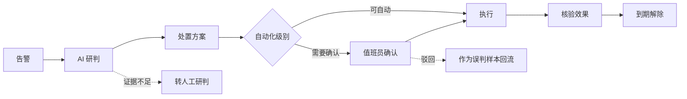

# 星烽 StarBeacon AI 自动化处置设计

本文定义目标功能和交付契约。当前代码、接口、工程页面、测试依据及未完成项见[功能实现与验收状态](功能实现与验收状态.md)。模型研判、决策策略、持续授权和处置确认的规则分别见[告警模型研判](告警模型研判.md)、[决策策略与影子评估](决策策略与影子评估.md)、[持续决策与自动授权](持续决策与自动授权.md)、[研判处置确认](研判处置确认.md)。

决策日期：2026-11-20。目标是让一条告警从出现到处置完成尽量不需要人逐条盯：AI 研判 → 给出处置方案 → 按授权执行 → 核验结果 → 到期解除。人负责定规则、确认高影响动作和纠正误判。

## 1. 处置流程

执行通道可组合使用联动插件、连接阻断和通知。联动插件支持设备封禁与主机隔离；连接阻断有两种通道：采集器在转发路径上的 Linux 网关时使用受控网关阻断，镜像口部署时使用旁路 RST 注入。[联动插件](联动插件设计.md) [连接阻断](连接阻断设计.md)

## 2. 自动化级别

| 级别 | AI 做什么 | 人做什么 | 对应的策略运行模式 |
| --- | --- | --- | --- |
| 仅观察 | 研判并给出方案，不执行 | 查看、评估策略 | `shadow` |
| **人机协同（默认）** | 研判并给出方案 | 逐条确认后执行 | `approval` |
| 条件自动 | 影响小的动作自动执行，其余等确认 | 确认高影响动作 | `automatic`，限定动作 |
| 全自动 | 策略授权范围内的动作都自动执行 | 事后复核 | `automatic` |

- **影响小的动作**默认包括不超过 2 小时的单个外部来源地址封禁和受控网关上的单连接限时阻断。隔离主机、封禁内部地址和更长的封禁属于高影响动作。这个划分可以按场景调整。
- 级别分两层：**全局级别是上限**，每个场景（一条决策策略）可以设得更低，不能更高。
- 新策略从“仅观察”开始，影子评估通过后才能提高。
- 全局级别和各场景的级别在“系统设置 → 自动处置”里配置，值守页面只读显示当前级别。
- 值守页面上有“暂停自动处置”按钮，按下后所有场景立即按人机协同处理，正在执行的动作不受影响。它是应急操作，不是配置。

升级后租户默认上限为人机协同，现有自动策略受这一上限约束。管理员可显式恢复自动级别，待确认的旧方案仍须确认。暂停仅收紧到人机协同，原本仅观察的场景保持原级别。新场景提高级别前，需要同一维护者在同一场景、判断条件和模型修订下获得有效匹配的影子评估。

当前持续决策把已有设备联动中的源 IP 限时封禁用于四级处置。v1.0.0 扩展到主机隔离、连接阻断和通知：主机隔离一律属于高影响动作；单条连接的网关阻断或 RST 注入属于影响小的动作。私有地址、共享地址、租户登记的内部或排除网段与资产接口按高影响处理。场景可收紧 2 小时小影响上限，实际设备租约仍受现有连接器限制。网关沿用已登记连接和既有确认授权。

v1.0.0 起，全局自动化上限、暂停自动处置和应急停止统一约束所有会自动产生设备动作的路径：决策策略、受控网关的规则即时触发及观察后的联动封禁、旁路 RST 注入、自动编排。各路径自己的开关仍然保留，只能比全局更严格。

## 3. 每一级都生效的保护

自动化级别只决定“要不要人点确认”，下面这些在任何级别都不能绕过：

1. **保护名单**：来源或目标在保护名单内，不生成设备动作。
2. **限时**：封禁和隔离都有期限，到期自动解除并回读确认。
3. **预算与冷却**：每条策略有每小时动作数上限，同一目标在冷却期内不重复处置。
4. **证据门槛**：研判结论、引用的证据、材料时效都满足才有执行资格。
5. **可追溯**：谁授权、依据什么、执行了什么、结果如何，都有记录。

具体门槛沿用[持续决策与自动授权](持续决策与自动授权.md)的“固定授权门槛”。模型给出的置信度是模型自报的分数，不是经过校准的攻击概率，页面上按“置信度”展示但不把它说成成功率。

## 4. 处置方案

AI 对每条需要处置的告警生成一份方案，值守页面逐条展示。

| 字段 | 说明 |
| --- | --- |
| 编号、告警 | 方案编号与对应告警 |
| AI 结论 | 真实攻击、可疑但证据不足、误报 |
| 置信度 | 模型自报分数 |
| 建议处置 | 封禁来源 2 小时、对当前连接应用限时网关规则、通知资产负责人等 |
| 执行通道 | 使用的插件、设备与网关策略 |
| 依据 | 引用的会话、规则、情报、资产信息，以及没拿到的证据 |
| 确认时限 | 超过时限未确认则不执行，并通知 |

值班员可以确认执行、驳回或查看依据。驳回时填写原因，这条记录作为误判样本进入评测集。

`GET /api/v1/decision-plans` 按权限提供待确认、处置流水和人工驳回样本。样本包含方案摘要、原材料摘要、策略及模型修订、驳回原因与处理者。人工驳回作为评测标签保留，领域真值需要独立核验。管理员仍通过原评估的处置确认接口执行，驳回与确认只能成功其一。某告警在同一策略修订内被驳回后，重复研判不能补签动作。

方案确认最长 15 分钟，并随原研判、评估和观测材料有效期缩短。超时后的处置流水留档，并通过订阅了质量事件的值班渠道发出方案编号和确认时限。超时不会签发、续期或恢复设备任务。

## 5. AI 值守页

“智能助手 → AI 值守”是自动化处置的操作台，只放值班要看和要做的事：

- 顶部：只读显示当前自动化级别（带“修改”链接到系统设置）、暂停自动处置。
- 指标：今日 AI 研判数与平均耗时、等待确认、已执行处置（其中自动执行多少）、误判纠正、保护名单拦截。
- 一张表，两种内容切换：“待确认”是等待确认的处置方案，按确认时限排序；“处置流水”是最近的研判、执行、解除、拦截和人工驳回。

自动化级别、各场景的级别和允许的动作属于系统级配置，放在“系统设置 → 自动处置”，不在值守页面上修改。

值守读取当前账号的待确认方案。今日指标按浏览器时区的自然日计算，待确认显示当前存量。已执行按设备回执计数，解除仅凭采集器回读记录。值守页可以暂停，恢复在系统设置提交。降低场景级别时保留原绑定，再次提级须通过原场景的有效影子评估。

原型见 `prototype/src/views/AiOpsView.vue` 和 `prototype/src/views/SystemSettingsView.vue`。

## 6. 全局 AI 助手

每个页面右上角都有“AI 助手”，打开后是右侧抽屉，自动带入当前页面作为上下文。独立的“智能对话”页保留，用于长对话。

- 能做的：研判当前告警、解释页面上的数据、生成处置编排草稿、生成联动插件草稿、按自然语言检索。
- 权限：只能读取当前账号有权限的数据；生成的编排和插件都是草稿；任何设备动作都要回到 AI 值守或响应动作页走授权，助手里不能直接执行。

助手发起的告警研判固定为仅观察，不进入持续决策或设备任务的评估资格。编排草稿提交给模型的内容限本次描述；插件草稿需要单独确认发送接口文档，后续试运行和签名沿用插件工作区。

原型见 `prototype/src/components/CopilotDrawer.vue`。

## 7. 自动化编排

“响应中心 → 自动化编排”。一条编排由若干步骤顺序组成：

| 步骤 | 作用 | 主要配置 |
| --- | --- | --- |
| 触发器 | 什么情况下启动 | 触发来源、最低严重级别、资产范围 |
| AI 研判 | 调用模型研判 | 置信度门槛、研判依据、低于门槛时怎么办 |
| 条件 | 判断后分支 | 判断条件、不满足时怎么办 |
| 保护名单检查 | 核对设备动作范围 | 原告警源和目的地址，以及动作绑定的探针注册代次 |
| 人工确认 | 等人确认 | 确认人、确认时限、超时怎么办 |
| 联动插件 | 调用设备 | 插件、动作、生效时长、到期自动解除 |
| 网关阻断 | 暂停指定连接的数据转发 | 方式、阻断策略、效果观察时长 |
| 核验 | 确认动作生效 | 回读设备、观察时长、仍有流量时怎么办 |
| 通知 | 通知相关人 | 通知对象、是否附带研判依据 |
| 补偿 | 出错或到期时撤销 | 撤销方式、结果未知时怎么办 |

两种建法：

- **AI 生成**：用一句话描述场景，例如“外部来源对核心业务发起高危 Web 攻击时，先断开连接，再封禁来源 2 小时，并通知值班组”，AI 给出步骤草稿，采用后可以继续修改。
- **自定义**：自己添加、删除、调序，逐步填写配置。

保存前校验：步骤数不超过上限；每个会改变设备或网络的步骤之前必须有保护名单检查，之后必须有核验；动作步骤有对应的解除方式。校验不通过不能发布。编排里的设备动作同样受第 3 节约束，不是另一条授权通道。

### 人工运行

2026-11-27 确认采用人工逐步运行。工作台最多保存 16 步，草稿可保留待填写的绑定。发布检查每组设备动作是否依次包含保护名单检查、人工确认、联动或网关动作、设备核验和到期解除，并核对当前模型、设备和策略修订。

操作员通过真实告警启动已发布修订，运行绑定原告警标识和原文摘要。AI 研判只进入人机协同评估，低于所选模型的置信度门槛时停止运行。联动插件采用现有人机协同处置确认，设备及联动配置摘要固定在发布修订中，期限按原通道上限校验。网关采用原人工研判触发的策略，设备签发前再次核对有效授权、两侧保护名单、观察时效和原有预算。

核验等待原设备任务的实际回执。网关配置回读和出侧流量观察分别记录，确实还有流量或观察效果未知时停止运行。到期解除步骤记录原租约期限，实际解除从原业务入口核对。通知由操作员完成后登记。

### 自动运行（v1.0）

2026-11-27 决定 v1.0.0 交付完整自动编排。人工逐步运行保留，作为没有自动触发条件的编排和应急处置的入口。

**触发与去重**

- 已发布修订可以声明一组触发条件：最低严重级别、规则族或规则编号、资产组、网络域、AI 研判结论与置信度下限。新告警持久接收并完成索引后，平台按条件匹配并自动启动运行。
- 同一告警、同一编排修订只启动一次。同一目标在冷却期内的重复告警并入已有运行，不再新开。每个编排有每小时启动上限，超出时登记为“已跳过”并计入处置流水。
- 编排停用、修订变化、暂停自动处置或应急停止生效后，不再启动新运行。

**步骤与分支**

- 步骤组成有向无环图。条件步骤有“满足”和“不满足”两个出口，AI 研判步骤可按结论（真实攻击、可疑、误报、证据不足）分支。图最多 32 个步骤，保存时校验无环、出口完整、每条路径都有结束。
- 不改变设备或网络的步骤自动执行：AI 研判、条件、通知、记录。通知步骤按通知渠道真实发送，送达结果写入运行记录。
- 设备动作步骤（联动插件封禁或隔离、受控网关阻断、旁路 RST 注入）按场景的自动化级别执行：人机协同时进入“待确认”，由确认人在时限内确认或驳回；条件自动时影响小的动作自动执行；全自动时在授权范围内自动执行。第 3 节的保护在每一级都生效。
- 人工确认步骤可以指定确认人或角色组，可以要求多人依次确认；超时按配置走超时出口，默认结束运行且不执行动作。

**重试、补偿与结束**

- 每个步骤声明超时和最大尝试次数。只读步骤和幂等的设备动作按退避重试；结果未知的设备动作先回读设备，再决定重试或补偿，不直接重发。
- 每个设备动作登记补偿动作（到期解除、立即解除、解除隔离）。运行失败、取消或应急停止时，按登记顺序逆序执行补偿，并回读确认。补偿本身失败时运行进入“结果未知”，通知值班渠道。
- 运行状态：排队中、运行中、待确认、已完成、失败、已取消、结果未知。平台重启后从最后一个已持久的步骤继续。
- 取消运行不等于设备动作已撤销，页面和通知分别显示取消结果与补偿结果。

**授权**

- 发布编排需要管理员权限。设备动作步骤的授权范围（目标方向、网段、最长期限、插件和设备）在发布时冻结，运行时不能扩大。
- 全局自动化上限、暂停自动处置和应急停止对自动运行同样生效，见第 2 节和第 10 节。

原型见 `prototype/src/views/PlaybookView.vue`。已有的剧本运行规则见[安全运营与数据治理设计](安全运营与数据治理设计.md)。

## 8. 时延目标

从告警进入平台算起，需实测：

| 环节 | 目标 |
| --- | --- |
| AI 研判完成 | P95 不超过 15 秒 |
| 生成处置方案 | 研判完成后 1 秒内 |
| 自动执行的动作下发到采集器 | 方案生成后 3 秒内 |
| 规则即时网关阻断 | 分别测量告警观测到网关回读、请求登记到网关回读 |

设备执行耗时取决于设备本身，单独计量。时延口径与测量方法见[应用识别与响应性能设计](应用识别与响应性能设计.md)。

## 10. 处置通知与应急控制（v1.0）

**通知。** 通知渠道增加“处置”分类，与告警、质量事件、报告分开订阅。下列事件发送处置通知：方案进入待确认（附确认时限）、方案超时、编排运行进入待确认或结果未知、设备动作失败或结果未知、网关或 RST 注入后仍有流量、应急停止开始和结束。已有的方案超时和网关观察通知改走“处置”分类。

**应急控制。** 系统设置提供“应急停止”：

1. 停止新动作：立即停止签发任何自动或人工的设备动作，正在等待确认的方案和运行暂停在原状态。
2. 撤销有效动作（可选）：对仍在期限内的封禁、隔离和网关条目逐条发起解除，并回读确认；解除失败或结果未知的条目单独列出。
3. 恢复：管理员解除应急停止后，暂停的方案和运行按原时限继续或超时，不自动补发已错过的动作。

应急停止、撤销进度和恢复都写入审计，并发送处置通知。

## 9. 验收要点

1. 四个级别的行为与第 2 节一致；全局级别能压住场景级别；暂停开关立即生效。
2. 保护名单、限时、预算、冷却在全自动下仍然生效。
3. 驳回的方案不执行，并进入评测集。
4. AI 生成的编排草稿不经校验不能发布；缺少保护名单检查或核验的编排被拒绝。
5. 助手不能直接触发设备动作。
6. 模型不可用、研判超时、证据不足时转人工，不产生处置授权。
