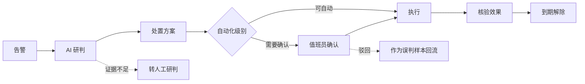

# 星烽 StarBeacon AI 自动化处置设计

本文定义目标功能、架构或交付契约；当前代码、接口、工程页面、测试依据及未完成项统一见[功能实现与验收状态](功能实现与验收状态.md)。已有的模型研判、决策策略、持续授权和处置确认是本设计的基础，各自的现行规则见[告警模型研判](告警模型研判.md)、[决策策略与影子评估](决策策略与影子评估.md)、[持续决策与自动授权](持续决策与自动授权.md)、[研判处置确认](研判处置确认.md)。本文新增的部分尚未实现。

决策日期：2026-11-20。目标是让一条告警从出现到处置完成尽量不需要人逐条盯：AI 研判 → 给出处置方案 → 按授权执行 → 核验结果 → 到期解除。人负责定规则、确认高影响动作和纠正误判。

## 1. 处置流程

执行通道有三种，可以组合：[联动插件](联动插件设计.md)（防火墙封禁、EDR 隔离）、[旁路阻断](旁路阻断设计.md)（先断开当前连接）、通知。

## 2. 自动化级别

| 级别 | AI 做什么 | 人做什么 | 对应的策略运行模式 |
| --- | --- | --- | --- |
| 仅观察 | 研判并给出方案，不执行 | 查看、评估策略 | `shadow` |
| **人机协同（默认）** | 研判并给出方案 | 逐条确认后执行 | `approval` |
| 条件自动 | 影响小的动作自动执行，其余等确认 | 确认高影响动作 | `automatic`，限定动作 |
| 全自动 | 策略授权范围内的动作都自动执行 | 事后复核 | `automatic` |

- **影响小的动作**默认指：封禁单个外部来源地址且不超过 2 小时、旁路阻断单条连接。隔离主机、封禁内部地址、更长的封禁都属于高影响动作。这个划分可以按场景调整。
- 级别分两层：**全局级别是上限**，每个场景（一条决策策略）可以设得更低，不能更高。
- 新策略从“仅观察”开始，影子评估通过后才能提高。
- 全局级别和各场景的级别在“系统设置 → 自动处置”里配置，值守页面只读显示当前级别。
- 值守页面上有“暂停自动处置”按钮，按下后所有场景立即按人机协同处理，正在执行的动作不受影响。它是应急操作，不是配置。

## 3. 每一级都生效的保护

自动化级别只决定“要不要人点确认”，下面这些在任何级别都不能绕过：

1. **保护名单**：来源或目标在保护名单内，不生成设备动作。
2. **限时**：封禁和隔离都有期限，到期自动解除并回读确认。
3. **预算与冷却**：每条策略有每小时动作数上限，同一目标在冷却期内不重复处置。
4. **证据门槛**：研判结论、引用的证据、材料时效都满足才有执行资格。
5. **可追溯**：谁授权、依据什么、执行了什么、结果如何，都有记录。

具体门槛沿用[持续决策与自动授权](持续决策与自动授权.md)的“固定授权门槛”。模型给出的置信度是模型自报的分数，不是经过校准的攻击概率，页面上按“置信度”展示但不把它说成成功率。

## 4. 处置方案

AI 对每条需要处置的告警生成一份方案，值守页面逐条展示。

| 字段 | 说明 |
| --- | --- |
| 编号、告警 | 方案编号与对应告警 |
| AI 结论 | 真实攻击、可疑但证据不足、误报 |
| 置信度 | 模型自报分数 |
| 建议处置 | 例如“封禁来源 2 小时”“旁路阻断当前连接并封禁”“通知资产负责人” |
| 执行通道 | 用哪个插件、哪台设备，是否先旁路阻断 |
| 依据 | 引用的会话、规则、情报、资产信息，以及没拿到的证据 |
| 确认时限 | 超过时限未确认则不执行，并通知 |

值班员可以确认执行、驳回或查看依据。驳回时填写原因，这条记录作为误判样本进入评测集。

## 5. AI 值守页

“智能助手 → AI 值守”是自动化处置的操作台，只放值班要看和要做的事：

- 顶部：只读显示当前自动化级别（带“修改”链接到系统设置）、暂停自动处置。
- 指标：今日 AI 研判数与平均耗时、等待确认、已执行处置（其中自动执行多少）、误判纠正、保护名单拦截。
- 一张表，两种内容切换：“待确认”是等待确认的处置方案，按确认时限排序；“处置流水”是最近的研判、执行、解除、拦截和人工驳回。

自动化级别、各场景的级别和允许的动作属于系统级配置，放在“系统设置 → 自动处置”，不在值守页面上修改。

原型见 `prototype/src/views/AiOpsView.vue` 和 `prototype/src/views/SystemSettingsView.vue`。

## 6. 全局 AI 助手

每个页面右上角都有“AI 助手”，打开后是右侧抽屉，自动带入当前页面作为上下文。独立的“智能对话”页保留，用于长对话。

- 能做的：研判当前告警、解释页面上的数据、生成处置编排草稿、生成联动插件草稿、按自然语言检索。
- 权限：只能读取当前账号有权限的数据；生成的编排和插件都是草稿；任何设备动作都要回到 AI 值守或响应动作页走授权，助手里不能直接执行。

原型见 `prototype/src/components/CopilotDrawer.vue`。

## 7. 自动化编排

“响应中心 → 自动化编排”。一条编排由若干步骤顺序组成：

| 步骤 | 作用 | 主要配置 |
| --- | --- | --- |
| 触发器 | 什么情况下启动 | 触发来源、最低严重级别、资产范围 |
| AI 研判 | 调用模型研判 | 置信度门槛、研判依据、低于门槛时怎么办 |
| 条件 | 判断后分支 | 判断条件、不满足时怎么办 |
| 人工确认 | 等人确认 | 确认人、确认时限、超时怎么办 |
| 联动插件 | 调用设备 | 插件、动作、生效时长、到期自动解除 |
| 旁路阻断 | 断开当前连接 | 方式、阻断策略、效果观察时长 |
| 核验 | 确认动作生效 | 回读设备、观察时长、仍有流量时怎么办 |
| 通知 | 通知相关人 | 通知对象、是否附带研判依据 |
| 补偿 | 出错或到期时撤销 | 撤销方式、结果未知时怎么办 |

两种建法：

- **AI 生成**：用一句话描述场景，例如“外部来源对核心业务发起高危 Web 攻击时，先断开连接，再封禁来源 2 小时，并通知值班组”，AI 给出步骤草稿，采用后可以继续修改。
- **自定义**：自己添加、删除、调序，逐步填写配置。

保存前校验：步骤数不超过上限；每个会改变设备或网络的步骤之前必须有保护名单检查，之后必须有核验；动作步骤有对应的解除方式。校验不通过不能发布。编排里的设备动作同样受第 3 节约束，不是另一条授权通道。

原型见 `prototype/src/views/PlaybookView.vue`。已有的剧本运行规则见[安全运营与数据治理设计](安全运营与数据治理设计.md)。

## 8. 时延目标

从告警进入平台算起，需实测：

| 环节 | 目标 |
| --- | --- |
| AI 研判完成 | P95 不超过 15 秒 |
| 生成处置方案 | 研判完成后 1 秒内 |
| 自动执行的动作下发到采集器 | 方案生成后 3 秒内 |
| 规则即时旁路阻断 | 命中后毫秒级，不经过平台 |

设备执行耗时取决于设备本身，单独计量。时延口径与测量方法见[应用识别与响应性能设计](应用识别与响应性能设计.md)。

## 9. 验收要点

1. 四个级别的行为与第 2 节一致；全局级别能压住场景级别；暂停开关立即生效。
2. 保护名单、限时、预算、冷却在全自动下仍然生效。
3. 驳回的方案不执行，并进入评测集。
4. AI 生成的编排草稿不经校验不能发布；缺少保护名单检查或核验的编排被拒绝。
5. 助手不能直接触发设备动作。
6. 模型不可用、研判超时、证据不足时转人工，不产生处置授权。
