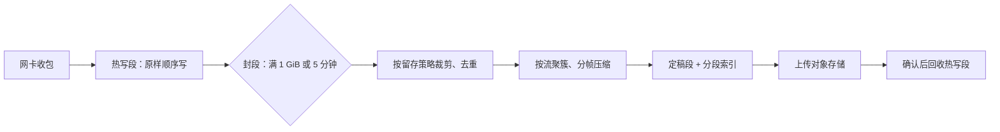

# 星烽 StarBeacon 全流量存储设计

本文定义目标功能、架构或交付契约；当前代码、接口、工程页面、测试依据及未完成项统一见[功能实现与验收状态](功能实现与验收状态.md)。本文内容尚未实现，文中的比例、时延和容量都是设计目标或算例，上线前必须在目标环境实测。

决策日期：2026-11-20。全流量回溯要同时满足四件事：采集不丢、落盘字节尽量少、单个会话取回快、索引便宜。做法是把数据分成三层，各自用最合适的方式保存，并把“存多少”交给可切换的留存策略。

## 1. 三层数据

| 层 | 内容 | 存放位置 | 体量 |
| --- | --- | --- | --- |
| 会话元数据 | 每个会话一条记录：五元组、起止时间、字节数、协议与应用、原包留存情况 | Elasticsearch | 小，全部保留 |
| 原包 | 报文原始字节，按时间分段 | 采集器本地盘，随后上传对象存储 | 大，按留存策略保留 |
| 分段索引 | 每个分段里有哪些流、各在哪些压缩帧 | 跟分段文件放在一起 | 约为分段体积的 0.3%–0.5% |

**逐包位置不进 Elasticsearch。** ES 只回答“有哪些会话”，取包时再读分段索引。这样 ES 文档数等于会话数而不是报文数，索引体积差两到三个数量级。

## 2. 留存策略

三种策略按探针或网络域选择，可以随时切换，切换只影响之后封存的分段。

| 策略 | 保留内容 | 适用 |
| --- | --- | --- |
| **智能留存（默认）** | 元数据全部保留；原包按下表裁剪 | 绝大多数环境 |
| 完整保存 | 捕获范围内的全部报文，不裁剪 | 有合规要求或流量很小的网络域 |
| 只存告警相关 | 元数据全部保留；只保留告警命中会话的原包 | 存储很紧张的分支 |

智能留存的裁剪规则（数值都是可调参数）：

| 流的类型 | 保留 | 原因 |
| --- | --- | --- |
| 告警命中的会话 | 完整保留 | 研判和取证需要全部字节 |
| 保护与观察名单内的地址 | 完整保留 | 重点对象不裁剪 |
| 加密流（TLS、QUIC、SSH） | 握手报文，加上每个方向握手后的前 16 KB | 密文无法分析，握手里有证书、SNI 和指纹 |
| 明文大传输（下载、视频、备份） | 每个方向前 1 MB | 攻击特征集中在开头 |
| 其余明文流 | 完整保留 | 体量小、价值高 |
| 镜像重复包 | 只留第一份 | 同一报文被两个镜像点各抓一次 |

被裁剪的会话在元数据里记为“按策略截断”，并记录原始字节数、保留字节数和策略修订号。页面、导出文件和清单都带这个标记，**不把截断的会话称为完整会话**；严格的完整会话导出只接受未裁剪的会话，判定条件见[PCAP 留存与会话完整性设计](PCAP留存与会话完整性设计.md)。

同类做法：Arkime 用规则对 TLS、QUIC 会话只保存前若干个包，并提供镜像包去重；Suricata 的包日志可以配置为密钥交换完成后不再记录加密流、不记录超过流深度的部分；Security Onion 默认每条流最多保存 1 MB。来源见文末。

## 3. 写入路径：先全量落盘，封段时再裁剪

裁剪不能在抓包的同时做：告警往往在会话进行到一半才出现，那时前面的报文如果已经丢弃就补不回来。所以分两步。



1. **热写段**：每个收包队列一个写线程、一个预分配好的文件，报文按到达顺序追加，不解析、不判断、不加锁。每秒落盘一次，断电最多丢最近一秒。
2. **封段**：分段满 1 GiB 或满 5 分钟时封存。此时这段时间里哪些会话命中了告警已经知道，再按留存策略决定每条流留多少。
3. **定稿段**：把保留下来的报文重写成最终格式（第 4 节），生成分段索引，核对摘要后上传，热写段在上传确认后回收。

告警如果在所属分段封存之后才出现，只能保留当时已经留下的部分，会话标记为“按策略截断”。封段间隔越长这种情况越少，占用的本地盘越多；5 分钟是起点，按实测调整。

封段跟不上时依次降级：先跳过按流聚簇，再跳过压缩，最后把热写段原样作为完整保存的分段上传。任何一级都记录原因并在探针质量页显示，不静默丢包。

## 4. 定稿段格式

沿用已有的“PCAPNG 逻辑字节流 + 独立 Zstandard 帧 + 旁路清单”，在其上增加流索引和按帧选择编码。

| 部分 | 内容 |
| --- | --- |
| 段头 | 格式版本、探针与捕获域、起止时间、留存策略及修订号、接口描述 |
| 数据帧 | 每帧约 1 MiB 原始数据，独立压缩、可单独解压；帧内报文按流聚在一起 |
| 帧目录 | 每帧的压缩偏移与长度、原始长度、编码方式、SHA-256 |
| 流表 | 每条流：五元组、起止时间、报文数、原始字节数、保留字节数、留存标记、所在帧的位图 |
| 地址过滤器 | 本段出现过的 IP 和“IP＋端口”的布隆过滤器，用来快速排除不相关的分段 |
| 段尾 | 整段原始字节与存储制品的 SHA-256 |

要点：

- **按流聚簇**：同一条流的报文连续存放。取一个小会话通常只需解压一到两帧，而不是散落在几十帧里；相似内容相邻，压缩率也更高。报文的原始到达顺序由时间戳保留，导出时按时间还原。
- **按帧选择编码**：封帧前先试压前 64 KiB，节省不到 5% 就原样存放。密文、视频、压缩包不值得花 CPU 去压。
- **压缩级别**：定稿段用 Zstandard 3 级；迁入冷层时用更高级别和长窗口重新压缩一次，原始字节摘要不变。
- **导出**：取回时还原成标准 PCAPNG，可以直接用 Wireshark 打开。

进阶优化，实测有收益再开启：

- **报文头与载荷分列**：把同一帧里的报文头和载荷分成两路存放。报文头高度重复，单独压缩效果好；密文载荷直接原样存放。
- **报文头精简**：分段内的时间戳存相邻差值，接口号等重复字段只存一次。

## 5. 取回一个会话

1. 在 ES 里按时间、地址、协议等条件查到会话记录，记录里带有探针、起止时间和留存标记。
2. 用探针和时间范围圈定候选分段，再用地址过滤器排除不含该地址的分段。
3. 读分段流表，得到这条流所在的帧。
4. 只读取这几帧（对象存储用范围读取），校验、解压，按五元组过滤。
5. 还原成 PCAPNG 返回，或在页面上逐包查看。

目标（需实测）：热层单个会话取回 P95 不超过 2 秒，温层不超过 10 秒；冷层取决于对象存储的恢复等待，页面显示预计时间。

## 6. 存储分层

| 层 | 介质 | 默认范围 | 说明 |
| --- | --- | --- | --- |
| 热 | 采集器本地 NVMe | 最近 3 天 | 取回最快；断网时兼作上传缓冲 |
| 温 | 对象存储标准层 | 3–30 天 | 范围读取，秒级取回 |
| 冷 | 对象存储低频层 | 30–180 天 | 迁入时重新压缩；取回可能需要先恢复 |

分层只改变介质和取回等待，不改变保留期限，也不改变报文身份。分段索引始终留在热层或温层，冷层的分段不用恢复就能回答“这个时间段有没有这个地址的流量”。

## 7. Elasticsearch 索引

沿用现有的“数据流 × 保留天数 × UTC 周期”共享索引和稳定文档标识，在此基础上调整以下几项。

| 项目 | 做法 |
| --- | --- |
| 索引模式 | 会话、协议记录和日志类索引启用 logsdb 模式 |
| 索引排序 | 按租户、探针、时间排序，相似文档相邻，压缩更好，按租户和探针过滤更快 |
| `_source` | 默认按现有方式保存并用最佳压缩；客户持有企业版授权时改用合成 `_source` |
| 字段 | 关闭动态映射；标识类用 `keyword`，地址用 `ip`；只展示不检索的字段不建索引；需要全文检索的字段用 `match_only_text` |
| 长连接 | 每隔固定时间写一条分段会话记录，只追加不更新 |
| 分片 | 主分片 10–50 GB；周期结束后合并为单段并设为只读 |
| 生命周期 | 热 → 温（合并、只读）→ 冷（低配节点）→ 到期删除 |

logsdb 模式在 Elasticsearch 8.17 正式可用，项目锁定的 9.5.4 已包含。它的收益分两部分：索引排序加更好的编码，不需要额外授权，社区经验约节省 20%–40%；合成 `_source` 需要企业版授权，Elastic 公布的数据是开启后合计最多约 65%–77%。**容量规划按没有企业版授权计算。** 上线前需要在锁定版本上验证两件事：非数据流索引启用 logsdb 的行为，以及索引排序对写入吞吐的影响。

算例：每天 1.2 亿条会话记录，假设每条在磁盘上约 200 字节，主分片每天约 24 GB；保留 180 天约 4.3 TB，含一个副本约 8.6 TB。每条记录的实际大小以压测为准。

不引入 ClickHouse：现有检索、关联和权限都建在 ES 上，换存储的代价远大于收益；会话记录量级在 ES 的合理范围内。

## 8. 容量估算

```text
每日观测字节   = 平均速率（字节/秒）× 86400
每日落盘字节   = 每日观测字节 × 留存比例
物理规划容量   = 每日落盘字节 × 保留天数 × 冗余系数 ÷ 最高磁盘利用率
```

留存比例等于各类流量的“字节占比 × 该类保留比例”之和。一个示例构成（不是承诺）：加密流占 80%，保留其中约 3%；明文大传输占 12%，保留约 1%；其余明文占 8%，全部保留；再加告警会话约 0.5%。合计约 11%。

平均 1 Gbit/s、保留 180 天、冗余系数 1.5、磁盘利用率上限 70%，不计压缩：

| 留存比例 | 180 天落盘 | 物理规划容量 |
| --- | ---: | ---: |
| 5% | 97 TB | 208 TB |
| 10% | 194 TB | 417 TB |
| 20% | 389 TB | 833 TB |
| 100%（完整保存） | 1,944 TB | 4,166 TB |

实际留存比例由流量构成决定，页面显示最近 24 小时和 7 天的实测值。采购容量以实测值为准，不用本表直接下单。

## 9. 配置项

留存策略和下面的参数是系统级配置，在“系统设置 → 全流量存储”里维护，同一处还显示热、温、冷三层的存储用量。“流量分析 → 会话与 PCAP → 全流量回溯”页面只放指标、会话检索和会话表，只读显示当前留存策略。

| 配置 | 默认 | 范围 |
| --- | --- | --- |
| 留存策略 | 智能留存 | 智能留存、完整保存、只存告警相关 |
| 加密流握手后保留 | 每方向 16 KB | 0–1 MB |
| 明文大传输保留 | 每方向 1 MB | 64 KB–64 MB |
| 封段条件 | 1 GiB 或 5 分钟 | 256 MiB–4 GiB，1–30 分钟 |
| 镜像去重窗口 | 50 毫秒 | 关闭，或 10–500 毫秒 |
| 热层保留 | 3 天 | 按本地盘容量 |
| 保留期限 | 180 天 | 见[数据留存与生命周期设计](数据留存与生命周期设计.md) |

镜像去重用 IP 头里转发途中不变的字段、传输层头和载荷算出的摘要判断重复；TTL、MAC 和 VLAN 标签不参与。间隔超过窗口的重传不算重复，照常保留。

## 10. 验收要点

1. **不丢**：目标速率下持续写入，逐段统计网卡、内核、写入三处的丢包；封段积压时按第 3 节降级并有记录。
2. **裁剪正确**：每类流按规则保留；告警命中的会话在封段窗口内完整保留；截断标记、原始字节数和保留字节数与实际一致。
3. **可还原**：保留下来的报文逐字节等于捕获时的字节，时间戳和顺序可还原；导出文件能被 Wireshark 打开。
4. **取回时延**：热、温、冷三层分别测单会话取回的 P50、P95。
5. **索引开销**：分段索引占比、ES 每条会话记录的磁盘字节、写入吞吐，分别对比启用 logsdb 和索引排序前后。
6. **故障**：封段中断电、上传成功但目录提交失败、分段索引损坏后重建。

## 参考来源

- Elasticsearch logsdb：[索引模式说明](https://www.elastic.co/search-labs/blog/elasticsearch-logsdb-index-mode)、[存储节省数据](https://www.elastic.co/observability-labs/blog/elasticsearch-logsdb-index-mode-storage-savings)、[存储演进](https://www.elastic.co/observability-labs/blog/elasticsearch-logsdb-storage-evolution)、[没有合成 `_source` 时的收益讨论](https://discuss.elastic.co/t/logsdb-without-synthetic-source-storage-savings-and-upgrade-risks/372858)
- Arkime：[设置项](https://arkime.com/settings)、[规则](https://arkime.com/rules)、[规则格式](https://arkime.com/rulesformat)、[常见问题](https://arkime.com/faq)
- Suricata：[包日志配置](https://docs.suricata.io/en/suricata-8.0.7/configuration/suricata-yaml.html#packet-log-pcap-log)
- Security Onion：[全包捕获](https://docs.securityonion.net/en/3/main/full-packet-capture/)、[Suricata 包捕获](https://docs.securityonion.net/en/2.4/suricata.html)
- 压缩与分帧的已有约束：[PCAP 压缩与存储布局设计](PCAP压缩与存储布局设计.md)
