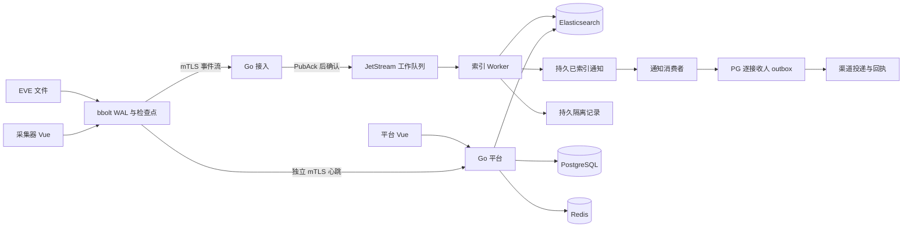

# 星烽 StarBeacon 工程实现与开发

工程记录日期：2026-10-17。仓库已经包含可编译、可运行的 Go 平台、接入进程、索引 Worker、采集器及两个 Vue 管理端。当前工程包含身份与租户用户管理、探针和事件链路、资产与网段修订、告警高级筛选、载荷字节视图、受签名任务、规则检查及离线重放、采集器通用 HTTPS 设备联动、现场 Agent 程序维护、运行与审计、通知及模型配置、统计型助手与周期报告及持久计划、态势统计和全屏展示、分类留存策略与 MCP 只读接入子流程。完整产品仍以[功能覆盖与验收矩阵](功能覆盖与验收矩阵.md)为目标；实际 107 项状态、代码／页面／测试引用和发布缺口统一见[功能实现与验收状态](功能实现与验收状态.md)。

当前测试、部署与历史证据统一见[测试覆盖与验收记录](测试覆盖与验收记录.md)，后续范围与完成条件见[实施与验收计划](实施与验收计划.md)。工程源码测试、真实网卡链路、页面交互、实际发行包和生产容量分别核验，不能相互授予资格。

## 1. 工程范围

| 工作域 | 当前代码行为 | 后续边界 |
| --- | --- | --- |
| 身份与会话 | 本地 bcrypt、8 小时会话、HttpOnly Cookie、CSRF、同源校验、登录限流与审计；租户用户目录、创建、角色／停用、CAS 与幂等、原子会话撤销及管理员保护；自身修改和管理员重置密码、修订验证、持久原密码验证预算 | 离线账号恢复、采集器本机密码维护、细粒度 RBAC、MFA、OIDC、设备凭据轮换 |
| 平台探针管理 | 登记、启停、心跳、CPU／内存／磁盘、实际网卡与 MAC/IP/MTU、版本、待传队列、捕获状态／配置修订／规则摘要；远程签名采集配置及实际生效回执；离线明确为历史观测；分组、站点、稳定分页与管理修订 | 多探针配置编排、证书续签及升级任务 |
| 采集器本地管理 | 独立认证、实际 Ethernet 网卡及 MAC/IP/MTU；线程/BPF/混杂参数、托管 AF_PACKET 引擎、原生就绪、失败保留／恢复／停止、配置和审计原子保存 | 管理 IP／路由／DNS 变更、跨站点质量与高流量验收 |
| 现场程序维护 | 管理员 Go CLI、独立发布签名、私有校验快照、有界 ZIP、修订与幂等、WAL 未决责任检查、持久切换、失败恢复、回退和启动守卫；Docker 后端及 systemd 服务模板 | 完整宿主安装、平台灰度、系统／检测引擎升级、全捕获健康、历史程序物理回收与跨版本数据兼容；systemd 仅在专属容器中实际运行验证 |
| 受控任务 | 独立 mTLS 长连接、Ed25519 签名、注册代次与能力／信任核验、PG 任务、设备 bbolt 回执、精确摘要确认、诊断任务；规则中断核实、响应原键确认与独立租约回读；两端最近列表与主键历史详情独立，执行截止与记录留存及清理保护分开显示；本地新任务固化默认 180 天期限，`SB_TASK_RETENTION_DAYS` 仅影响未来任务；启动和每分钟按冻结期限执行独立有界回收，扫描／删除预算为 200／100，续点与账目原子保存，失败保留原数据并报告健康异常 | 全任务类型的未知结果核实、完整租户配额、升级与强制停止 |
| 设备联动 | 管理员显式提交通用 HTTPS 限时任务，由指定采集器执行；原评估处置确认绑定当前证据、策略、探针注册与设备配置，授权档案、签名任务及审计同事务提交；持续策略绑定本人新研判及模型修订，限时自动授权核对固定事实条件、去重、目标冷却和每小时预算；固定 IP／私有 CA／Bearer、管理地址保护、独立租约、绝对到期、条件解除、单次写后回读、持久意图与不可变回执、重启只读恢复 | 自动研判的规模/故障恢复验收、跨账号托管、多级审批、具体设备适配及真实流量效果、认证插件、凭据轮换、设备 HA；隔离协议端点不授予真实网络封禁资格 |
| 规则管理 | CodeMirror 编辑器、不可变修订、受限 AI 候选与 SID 资格、原生 `-T`、同设备完整包正反样本资格、签名部署、固定历史修订回滚与中断核实 | 完整引擎语义由原生检查决定；来源管理、TUF、自动灰度与真实模型效果 |
| PCAP 重放 | 两端导入、平台选探针、指定规则／登记快照、原生隔离 `-r`、SHA-256、观测握手质量、样本默认 180 天、原子名额及有界清理 | 重放样本逐包协议树；真实 S3／完整发行包验收 |
| 原包归档与导出 | 独立 AF_PACKET 捕获、PCAPNG、分帧 Zstandard、持久暂存游标、mTLS 版本上传、两端目录、逐包协议字段／原文查看及原字节下载；平台受限跨切片 TCP 完整会话或显式快照导出 | 大规模会话索引、长连接／分卷导出、TFO／RST／分片完整性资格、真实对象存储与容量；完整生产资格仍待核验 |
| 事件接入 | 原生网卡捕获或外部 EVE、来源代次与偏移、持久轮转排空、bbolt 队列、mTLS gRPC、路由与摘要核验、持久确认 | 多来源采集、硬件采集、流量计量 |
| 索引分析 | EVE 标准化、严格 ES 映射、Bulk 分项结果、不可变 ID 重放、异常持久隔离；单告警模型研判冻结材料与来源 | 关联检测、产品识别、置信度领域评测、攻击成功验证与全量自动研判 |
| 告警检索 | 时间／级别／IP／方法／协议／路径，Participle 类型化 AST、MAC、字段目录；EVE 载荷 HEX／严格 UTF-8／偏移分页／复制；个人／团队保存查询、固定／相对窗口复用；前 10,000 条有界分页与独立固定 PIT 的 CSV 元数据导出 | 列表一致快照、更大范围与容量验收、Wireshark 主流运算扩展、逐包／会话原生检索与完整应用协议视图；超出当前导出预算明确拒绝 |
| 资产与网络 | 人工资产／资产组／CIDR 网段、多接口／IP／6 字节 MAC、修订与 CAS、历史页面 | 自动发现、租约／NAT／账号、动态组、业务拓扑、资产历史有效区间关联 |
| 应用识别规则 | HTTP／DNS／TLS／QUIC 可见名称条件、组合／排除、不可变修订与输入验证；单探针完整签名快照、CAS 与注册身份、同步安装和恢复；独立 EVE 分类上报、原部署复算与详情；未知／候选／冲突及摘要 | 活跃流周期计量、会话关联、跨探针计量域、应用统计、真实产品样本效果、灰度与自动订阅；名称候选不等于品牌准确率或应用字节 |
| 通知与日志输出 | 邮件／企业微信／钉钉／飞书／Webhook／Syslog TLS，告警及明确订阅的租户操作／登录审计事务 outbox、逐接收人回执、抑制与人工重试、渠道／日志分表页签 | 真实办公服务商资格、原始 EVE／进程日志全集归档、历史补发／缺口水位、升级通知与容量验收 |
| 模型配置 | 官方 SDK Responses／Chat 兼容协议、加密修订、连接验证／分析／规则生成／单告警研判共用预算、幂等、UTC 日额度与跨实例并发；独立配置／结果弹窗 | 真实模型服务、领域评测／路由、Jev／Laya 的准确项目与接口资格；MCP 仅开放现有只读查询工具 |
| MCP 服务 | 官方 Go SDK 1.8.0、HTTPS/OAuth 资源发现、可信令牌内省、租户身份绑定、修订／停用／删除／到期；九个只读工具、告警与协议独立授权、数据集字段目录和表达式校验、预算、输出上限及操作审计 | 真实企业授权方、客户 Agent 兼容矩阵、收费分析工具、资源下载与细粒度业务域授权 |
| 智能助手与安全报告 | 私有统计型对话、日报／周报／月报、持久日历计划与错过范围、时区自然周期、冻结来源与摘要、River 事务队列、配额、取消／未知结果、统计降级和认证 HTML 导出 | 调查工具、SSE、知识、计划实际恢复验收／迟到补偿、审批发布／PDF／投递、真实模型效果 |
| 态势统计与大屏 | 真实告警聚合、登记资产与探针状态；完整响应校验、共享窗口、缓存/锁/预算；固定窗口下钻与全屏 | 风险/处置/应用/集团聚合、统计水位、模板/投屏权限与离线报告 |
| 事件调查 | 人工线索、唯一告警身份与摘要关联、责任分派、CAS 调查修订、结构化结案、重开及时间线；活动历史与分类期限保护 | 自动升级／分派、附件／任务／SLA、合并拆分／共享、外部工单及复盘知识审核；同源码端到端验收 |
| 运行观测 | 就绪／Prometheus／结构化日志、依赖及宿主健康；原生捕获计数／观察时间／暂存占用；运行状态、操作和登录日志独立页签及游标筛选 | 镜像缺失／质量归因、告警规则、统一追踪、全域审计与故障演练 |
| 生命周期 | 十一类默认 180 天；分类编辑、创建人影响预览、CAS／幂等发布与审计；租户新建分区固定 ILM，新记录期限；活跃配置独立保存 | 历史重算、PG 全域物理清理、保全／销毁／备份治理、文件生命周期 |

决策策略提供有界 CEL 定义、不可变修订、保护网段与按需影子评估，复用本人冻结研判。影子判断本身不授权设备动作；管理员可在原评估中独立确认一次限时处置，目标来自原评估，提交时核对当前材料和执行资格，原键核对返回原任务与原期限。模型配置中的独立页签通过表格与弹窗维护，持续模式绑定模型修订，处理当前修订启用后创建并完成的本人研判；独立开启自动研判许可后，指定探针与等级的新观测告警按日额度自动登记和提交，执行前再核对当前许可；自动模式在不可变独立档案中核对事实、探针与设备、去重、冷却及预算，再原子提交签名限时任务。自动模式不能通过人工确认接口再提交。详见[决策策略与影子评估](决策策略与影子评估.md)、[持续决策与自动授权](持续决策与自动授权.md)及[研判处置确认](研判处置确认.md)。自动研判的规模/故障恢复验收、跨账号托管、多级审批、置信度校准与真实设备效果仍须交付。

应用识别规则提供产品名称与类别、HTTP Host／可见 SNI／DNS 条件、组合与排除依据、不可变修订、输入验证和独立单探针部署。管理员冻结规则摘要、注册代次和当前状态；采集器经同步持久化后切换匹配器，分类与原字节共同进入 WAL，平台按原部署复算。告警、协议记录、安装回执和探针详情分别展示对应依据。输入验证、实际分类和应用字节计量具有独立边界，详见[应用识别规则与采集器分类](应用识别规则与输入验证.md)。

已实现子流程不能替代整项功能。当前远程结果分别绑定后端、前端和 ZIP 来源，不继承历史截图或旧构建资格；原生角色替换可能产生捕获缺口。置信度领域评测、全量告警自动研判、具体设备效果、平台灰度与系统／检测引擎升级、应用会话归因与计量、文件沙箱、集团治理和生产容量仍有缺口。真实外部条件未具备的功能按未验收记录，不能用受控协议通过替代领域效果。原始失败和历史验收集中保留于[测试覆盖与验收记录](测试覆盖与验收记录.md)。

## 2. 目录与运行角色

```text
StarBeacon/
├── cmd/
│   ├── starbeacon/             # 平台 HTTP API 与独立 gRPC 控制流
│   ├── starbeacon-ingest/      # 事件接入、路由与持久接收
│   ├── starbeacon-worker/      # 标准化、索引、隔离和已索引通知
│   ├── starbeacon-agent/       # Go 采集器、本地管理与持久上报
│   └── starbeaconctl/          # 迁移、初始化、权限与开发签发
├── internal/                  # 按职责分包，见 internal/README.md
├── api/
│   ├── proto/                 # gRPC 源契约
│   ├── sensor/v1/             # 固定生成器生成的 Go 源
│   └── openapi/               # 当前平台与采集器 HTTP 契约
├── migrations/                # Goose SQL 与嵌入资源
├── web/
│   ├── platform/              # 平台 Vue 应用
│   ├── collector/             # 采集器独立 Vue 应用
│   └── packages/shared/       # 类型、主题、会话客户端和公共组件
├── deploy/                    # 开发依赖 Compose、NATS 配置、Go 镜像与同源代理示例
├── scripts/                   # 开发初始化、环境加载、样本与集成入口
├── tests/integration/         # 真实 PG/NATS/ES/mTLS 测试
├── .github/workflows/         # Go 与前端 CI
├── prototype/                 # 完整交互设计与合成数据，独立保留
└── docs/                      # 产品、架构、契约及实施文档
```

模块依赖保持单向：入口 → 配置与组装 → 平台／采集／接入／分析 → 契约与存储。当前一个 Go module、五个二进制；前端两个独立应用共用一个 pnpm workspace。模型、取证与设备连接器使用各自受限的适配边界，不复制协议解析器、数据库驱动或密码算法。设备联动的配置、协议、文件权限和结果未知处理见[HTTP 联动与限时封禁](HTTP联动与限时封禁.md)。



## 3. 实际工具链与依赖

| 项目 | 本工程固定版本／配置 |
| --- | --- |
| Go | 1.26.8；`go 1.26.0`、`toolchain go1.26.8`、`GOTOOLCHAIN=local` |
| PostgreSQL / Redis / ES / NATS | 18.6 / 8.10.2 / 9.5.4 / 2.15.0，独立开发容器已联调 |
| 前端 | Node 24.19.0、pnpm 12.6.0、Vue 3.5.43、Ant Design Vue 4.2.6 |
| 路由与构建 | Vue Router 5.3.1、Vite 8.3.1、TypeScript 6.0.3、vue-tsc 3.3.11 |
| 迁移／边缘状态／健康 | Goose 3.28.0、bbolt 1.5.0、gopsutil 4.26.8 |
| 重放解析／存储 | GoPacket v1.7.2、minio-go/v7 v7.3.0；原生 Suricata 8.0.7，Linux 隔离依赖 bubblewrap 0.13.0 |
| 编码生成 | protoc 36.2、Go 插件 1.36.12、gRPC 插件 1.6.2 |
| Go 依赖锁 | 根 `go.mod/go.sum`；直接模块与完整依赖图由 `go list -m all` 核对 |
| 检索／模型／邮件 | Participle v2.1.4、官方 OpenAI Go SDK v3.70.0、go-mail v0.8.1 |
| 分析任务队列 | River 与 riverpgxv5 v0.47.0，复用 PostgreSQL，无独立 MQ 容器 |
| MCP 协议服务 | 官方 Go SDK v1.8.0，复用平台 HTTP、PG 与 Redis，不启动独立协议容器 |
| 前端测试 | Vitest／V8 v5.0.3、Vue Test Utils v2.5.1、jsdom v30.1.1；统计包含两端与共享代码 |
| 开发辅助脚本 | Python 3 标准库；本机验证为 3.14.6，不是后端服务运行依赖 |

Makefile 强制 `GOTOOLCHAIN=local` 并核对精确 Go 1.26.8，构建、测试、生成及集成检查都须使用该补丁。PATH 中的 `go` 已是 1.26.8 时可直接运行，否则通过 `GO=/绝对路径/go` 指定已安装的工具链。本机 `go version` 可按 go.mod 自动选择 1.26.8，但 `GOTOOLCHAIN=local go version` 实测为 1.25.6；这只是本机环境记录，不能作为所有开发者的系统前提。完整产品的选型与条件组件见[依赖版本与部署清单](依赖版本与部署清单.md)，没有代码调用的条件 SDK 不进入当前锁文件。

## 4. 本地启动

需要 Go 1.26.8、Node 24.19.0、pnpm 12.6.0、Python 3、Docker 与 Compose plugin。首次从仓库根目录运行：

```sh
make dev-setup GO=/绝对路径/go
pnpm --dir web install --frozen-lockfile
```

`dev-setup` 编译五个入口、生成独立随机凭据、启动开发依赖、迁移数据库、建立非超级用户运行角色、初始化本地租户和管理员、签发开发证书、登记采集器，并建立独立平台命令签名密钥及采集器信任公钥。配置保存在 Git 忽略的 `.local/`，目录权限 0700，凭据及私钥 0600。重跑保留已有凭据、账号和采集器身份；匹配失败时返回错误，不重置管理员密码。

开发 Compose 仅包含 PG、Redis、NATS 与 ES，不包含 Go 角色、前端、Nginx、MinIO AIStor 或原生 Suricata。启动命令读取已经编译的二进制，不再使用 Go 编译器；后续重新构建或运行集成测试仍须沿用精确工具链。

分别在六个终端启动：

```sh
make platform
make ingest
make worker
make collector
make web
make collector-web
```

| 入口 | 本地地址 | 说明 |
| --- | --- | --- |
| 平台页面 | `http://127.0.0.1:5174/` | 平台账号位于 `.local/login.env` |
| 采集器页面 | `http://127.0.0.1:5175/` | 本地账号 `admin`，密码位于 `.local/collector.env` 的 `SB_LOCAL_PASSWORD` |
| 平台 HTTP / gRPC 控制 | `127.0.0.1:28080` / `127.0.0.1:29091` | Cookie 与本地采集器分开 |
| 接入 HTTP / gRPC 事件 | `127.0.0.1:28180` / `127.0.0.1:29090` | 事件批次与控制使用独立连接 |
| Worker / 采集器 HTTP | `127.0.0.1:28181` / `127.0.0.1:28081` | 运维与本地 API |
| PG / Redis / NATS / ES | `25432` / `26379` / `24222` / `29200` | 全部绑定宿主回环；NATS 监控端口 `28222` |

前端 Vite `/api` 保持原始 Origin，分别代理到 28080／28081。三端使用 History 路由，保留旧 hash 迁移、两工程端的登录完整路径回跳与 404；工作区 view 查询参数支持刷新及历史恢复。当前 Go API 不内置前端静态文件；前端产物位于各应用的 `dist/`。生产需同源 HTTPS 静态入口并代理对应 API，限制运维端点访问。[平台 Nginx 示例](../deploy/nginx/platform.conf)与[采集器示例](../deploy/nginx/collector.conf)包含 API 代理、资源 404、SPA 回退、100 MiB 上传和 360 秒代理期限；两模板均 `listen 80`、`server_name _`，应配置各自实际主机名／监听入口及 TLS，不能原样在同一监听入口同时启用。`SB_ALLOWED_ORIGIN` 必须匹配该端实际外部来源（无路径，生产为 HTTPS），代理保留原始 Origin。这些是部署示例，生产 TLS 与实际代理尚未验收。

平台 `/sensors` 的「探针列表／探针分组／任务记录」使用 `view=devices/groups/tasks`，`/rules` 的「规则包／重放样本／重放任务」使用 `view=packages/samples/tasks`；采集器 `/network` 的「网卡与状态／采集配置／重放样本／任务记录」使用 `view=interfaces/capture/samples/tasks`。同一视图只显示所属业务数据集。现有完整原型仍在 4173，可以与两个工程应用共存；因直接复用共享规则编辑器及工具源，原型安装／构建前须先完成 `pnpm --dir web install --frozen-lockfile`。

Docker Hub 不可达时可用官方镜像的 ECR Public 副本：

```sh
make dev-setup GO=/绝对路径/go \
  COMPOSE_FILES='-f deploy/compose.yaml -f deploy/compose.registry.yaml'
```

Redis／NATS 副本按已核验的 manifest digest 固定，实际运行版本仍需检查。开发使用独立 Compose project 和命名卷，不复用其他项目的数据库。`make deps-stop` 保留卷；重置数据必须明确选择开发卷，不能直接套用到生产。Docker 凭据辅助程序无响应属于本机 Docker 环境问题；可用独立 `DOCKER_CONFIG` 指定无凭据配置和现有 CLI plugin 目录排查，不覆盖系统凭据配置。

### 4.1 EVE 数据入口

开发默认读取 `.local/eve.json`。`make sample` 向它追加一条明确标记的工程验收 EVE，使用保留示例 IP，不向外部网络发送攻击流量。此样本验证上报和索引流程，不证明真实 Suricata 抓包或规则命中。

接入已有 Suricata 时，在采集器环境中配置 `SB_EVE_PATH`，给代理只读文件和轮转目录权限；确认 Suricata 实际版本、EVE 输出和 Ethernet 字段配置。使用 rename/create 轮转，保留旧 inode 到代理读完；检查点后旧文件已被删除时，读取停止并报告异常，不默默跳过缺失来源。copytruncate 即使有前缀检测也不能保证在所有覆盖／快速增长情况下识别，不能作为可靠生产轮转策略。

当前代理每轮最多读取 100 条／约 2 MiB，完整换行后才推进偏移；单条超过 1 MiB 时停止读取并报告异常。它不把超大原文截断为正常告警。处理大包、TCP 重组和检查深度仍由真正的捕获与 Suricata 模块验收，不能把 EVE 大小限制当成大包检测能力。

Linux 托管模式设置 `SB_CAPTURE_MANAGED=true`，使用可信 Suricata 8.0.7 模板及 tcpdump BPF 编译器。模板、分类／引用／阈值文件经过有界读取，私有工作目录由采集器维护；不得引用外部 YAML 或插件。每张网卡支持 1–64 个线程，最多 16 张网卡、总计 128 个线程；BPF 按 UTF-8 字节计最多 2048。先隔离执行规则装载和无网卡 BPF 编译，再停旧进程、启动并确认实际 AF_PACKET 轮询。混杂模式与内核校验和卸载标记仅用于捕获，不修改宿主网卡的卸载设置。配置应用会产生采集间隙，应在维护窗口执行；捕获状态与期望配置分开保存，不能把 HTTP 成功响应视为检测已生效。

`SB_CAPTURE_SPOOL_BYTES` 默认 1 GiB、至少 100 MiB，`SB_CAPTURE_ROTATE_BYTES` 默认 64 MiB 且不超过暂存额度的一半，可配置为 1 MiB 到半额度。托管模式采用持久轮转记录、单个待排空来源和原生 `reopen-log-files`；实际检测进程关闭旧 inode、全部字节进入 WAL、后继来源断点原子提交后才回收旧文件。中断恢复核对身份、前缀和排空位置，不跳过缺失来源。暂存超额或轮转无法核对时停止检测并报告异常，待传事件继续保留；两秒监控不是文件系统硬配额，生产仍须独立磁盘额度和容量告警。EVE 属于检测流水线暂存，不代替默认 180 天的 PCAP／业务数据归档。

### 4.2 通知与模型出站

平台与 Worker 通过 `SB_CREDENTIAL_KEY` 或对应 `_FILE` 注入同一 32 字节十六进制加密密钥；不入 Git、镜像、API 或审计。`SB_OUTBOUND_PRIVATE_NETWORKS` 明确允许的私网 CIDR，`SB_OUTBOUND_CA` 指定受信任 CA。固定 DNS/目标校验、禁用环境代理、禁止元数据地址；生产办公 HTTP 出站要求 TLS，Syslog TCP 仅用于开发。没有密钥时页面显示服务未启用，不能配置或测试。模型公网调用需要提供方 `allow_external` 明确允许。

模型连接测试使用固定短文本，最多 15 秒请求、64 输出 token，预算以 UTC 日和当前不可变修订核算；同一提供方一个请求、每租户跨实例四个。输出拒答、截断、凭据失败和未知结果分别记录；无完整用量或耗时证据就显示未知，实际观测到的零值保留为零。没有自动重试可能已经计费的请求。通知摘要不含 IP、URL、载荷或密钥，每个邮件接收人独立 outbox；未知结果人工核实后才重试，渠道受理、已读、TCP 完整写入和远端落盘分开。


#### Syslog 审计外发

在通知渠道中选择 Syslog TLS，并选择“安全告警”“操作日志”“登录日志”。历史配置及未指定类别的新渠道默认只发送告警；办公通知渠道只能发送告警摘要。编辑未指定类别时保留既有范围，空类别配置无效。告警级别只筛选安全告警，审计专用渠道不必配置告警级别。

操作与登录审计在原事务中写入绑定渠道修订的脱敏投递材料；服务中断后仍可继续领取待投递记录，不依赖内存缓冲或易遗漏的时间游标。保存渠道本身也属于操作审计。停用或静默时记录抑制状态；配置修订发生变化后取消原修订的待投递任务，不将旧目的地悄然换成新目的地。投递过程失败、未知结果、人工重试和重复风险沿用通知队列契约。

每个审计帧包含原始审计 ID、类别、时间、账号或数据库操作角色、动作、对象、请求标识、来源 IP 和受限 User-Agent；登录帧包含验证结果与阶段。仅证明密码验证结果，不能当作已建立完整会话。超限或控制字符处理后标记 `truncated`，不伪装完整原件。密码、请求正文、配置凭据和操作原因不进入外发材料；审计详情仍按平台权限查看。无法确定租户的登录失败保存在平台审计中，不猜测租户或向任一租户外发。

审计帧使用 RFC 5424、六位以内时间小数和 UTF-8 BOM；TLS 按 RFC 5425 的 UTF-8 字节数分帧。[RFC 5424](https://www.rfc-editor.org/rfc/rfc5424)、[RFC 5425](https://www.rfc-editor.org/rfc/rfc5425)。Syslog 的发送容量由有界工作进程控制，不套用办公机器人的三秒间隔。投递材料保留期为通知策略与来源日志到期时间中的较早者，两者默认均为 180 天。`transport_written` 只表示传输写入，不确认远端落盘。原始 EVE、普通进程日志全集、历史补发及大流量容量仍需独立交付和验收。

### 4.3 规则与样本验证入口

平台「规则管理」创建规则包修订并选择探针装载检查；两端的重放样本与任务分属独立页签。共享 CodeMirror 编辑器提供高亮、行号、撤销、换行及点击定位，基础诊断检查受控 `alert` 规则的头字段、引号／转义、括号结构、末分号、SID 范围／重复、rev 及 900 KiB 上限；它不是完整 Suricata 解析器。关键词、变量和引擎兼容必须由选定探针的原生 `-T` 确认。需要受信任的 Suricata 8.0.7 与隔离环境，在采集器配置 `SB_SURICATA_BINARY`、`SB_SURICATA_CONFIG`，需要登记规则快照时再配置 `SB_SURICATA_RULES_PATH`。具体限额、样本存储、Linux 隔离依赖、生产 S3 和结果解释见[PCAP 重放与规则验证](PCAP重放与规则验证.md)。普通 Go scratch 镜像不能直接作为包含原生重放环境的采集器镜像。

## 5. 交付、隔离与恢复语义

1. 证书 URI 唯一绑定租户、探针和注册代次，TLS 1.3 验证信任链。PG 业务事务使用 transaction-local 租户设置，业务记录采用 FORCE RLS；既有登录身份读取是专门例外，用户维护使用固定受控函数重新核对当前租户及操作者，运行角色不能直接写入身份表。启动检查原始连接身份、会话身份及有效角色，拒绝超级用户、BYPASSRLS、CREATEROLE、CREATEDB、REPLICATION，以及直接持有、继承或可切换取得的业务表所有者权限；检查覆盖 `public` 与 `starbeacon_jobs` 全部表，不依赖手工维护的表名清单。既不能继承也不能切换的普通成员关系不作为特权使用。
2. 事件 ID 由注册代次、来源代次、原文偏移和行内序号确定。bbolt 同一同步事务保存数据、序号、额度和来源检查点；额度不足时全部回滚，不能只保存部分记录却推进来源。
3. 平台路由固定 UTC 日期分区，重试继续使用原路由。接入每帧核验启用状态、路由、范围、摘要和身份，JetStream PubAck 成功后才返回精确 ACK。
4. 采集器仅回收与当前批次身份、原文摘要及精确序号范围一致的数据。它不根据一个无范围的全局水位删除其他流、旧注册或缺号区间。
5. Alerts／Context 使用 WorkQueue、File Storage、`MaxAge=0` 和 `DiscardNew`。未索引数据不被时间淘汰；满载拒绝新发布，使本地队列与来源产生背压。共享索引消费者在全部有效文档／隔离记录和已索引通知持久化后 DoubleAck，回收接入缓冲。[JetStream 留存语义](https://docs.nats.io/learn/jetstream/retention-policies)
6. ES Bulk 逐项核验；201 为新写入，409 必须核对不可变来源和原文摘要，429／依赖故障重试。400 映射拒绝、无效 EVE、无效 UTF-8 或事件流不匹配进入持久隔离，不伪装成正常告警。

传递保证是至少一次加幂等索引。NATS 2 分钟去重窗口不是跨重启的永久唯一保证；稳定 ES `_id` 和 409 来源核验承担长期重放边界。接入 ACK 表示队列持久接收，Worker DoubleAck 表示索引流程完成，ES refresh 后才可搜索，三者不合并。

工作队列不是供多个独立分析订阅者共享历史的总线：WorkQueue 不允许重叠的独立消费者。后续分析从已索引通知／ES，或经过明确设计的独立持久分发流读取。当前已索引通知为 72 小时运行缓冲，隔离记录为默认 180 天，各流默认上限 256 MiB；通知消费者在摘要持久进入 PG outbox 后才确认通知消息；投递日志默认 180 天，与 72 小时运行缓冲分别治理。不能将运行缓冲 TTL 当成业务留存，也不能靠提高 TTL 无限积累消息。

本地 WAL 默认 256 MiB，配置 `SB_WAL_BYTES`；该额度是待传记录编码字节，bbolt 文件可以保留更大的已分配页。暂未实现在线压缩及离线 compaction 编排。队列满会停止源读取，Suricata 文件轮转容量和磁盘配额也必须承接背压；任何容量都不足时需要显式报警和缺口处理，当前不会自动清队列换取继续运行。

ES 索引默认每租户／路由 UTC 日期／数据流一个主分片及一个副本，以首次路由日期作 ILM 起点。此实现便于验证身份和重放，不能直接外推到大量 SaaS 租户；租户打包、分片预算、PIT、热点和数据单元调度另需实现与容量测试。当前检索单次范围最多 31 天、页大小最多 100、最多前 10000 条，不是无限历史遍历。

## 6. 留存、凭据和执行边界

PG 为 `alerts/pcap/network/operations/logins/notifications/reports/files/asset_history/models/incidents` 十一类初始化 180 天默认策略，迁移补齐缺失类别并保留已有自定义天数。管理员在「数据留存」配置 1–3650 天，通过五分钟创建人预览、CAS 与精确幂等发布；操作审计、发布记录与策略同事务。仅支持未来对象，当前未开放存量期限重算。

索引 Worker 始终需要最小权限 PG 账号读取策略。告警／网络事件的租户 UTC 日期分区首次创建时固定 ILM，旧分区不因策略变更调整，同日数据仍沿用已固定期限。自有 ES 模板关闭匹配索引的自动创建，模板或已有生命周期定义漂移时拒绝覆盖；索引不存在导致的写入失败会清除本进程缓存，并由受控创建路径重建。缓存只在同一索引或策略内合并并发，不串行阻塞不同分区。

操作、登录、资产历史、模型／通知配置历史、分析作业、任务及重放样本在创建时读取所属类别策略并记录到期时间。活跃配置独立保存；文件类别策略已登记，流水线尚未接入。本地审计在写入时有界清理；平台每分钟按固化期限回收已接入的 PG 历史和短期对象。每轮 20 秒／32 个租户／4096 条，单租户最多 1024 条、单表最多 256 条；分类续点与删除同事务，锁冲突回滚，跨实例跳过被锁定的维护行。当前配置、活动任务、未知规则安装及被引用版本受保护。匿名登录记录仅在无业务租户的维护事务中回收，普通租户查询不可见。规则历史、物理分区、全域保全、存量重算及备份销毁尚未完成。重放样本已执行对象与目录清理，但持续捕获及全域生命周期未完成，不能据此声称全部业务生命周期已经落地。

开发证书只用于回环联调：CA 有效期 365 天、服务及探针证书 30 天。开发 CLI 支持 `dev-pki --server-hosts` 显式附加 DNS/IP SAN，并保护文件创建失败的原子回收；续签、撤销、轮换、失效预警和生产证书发布仍需实现。运行进程不持有 CA 私钥或迁移 DSN；CLI 是独立运维工具，开发脚本配置中的私钥不得作为生产镜像层或仓库文件。

生产模式要求依赖 TLS、PG `sslmode=verify-full`、ES API Key、HTTPS Origin 和至少 R3 的接入队列。所有 HTTP 当前仍只监听回环，跨主机入口需要受控网关／同源代理与内部可信 CA 配置。生产校验只阻止明显不安全配置，不代表已完成生产 HA、备份恢复、认证强度和权限验收。

登录与操作审计默认使用实际连接来源。单层受控代理部署时，平台和采集器可配置 `SB_TRUSTED_PROXY_CIDRS=127.0.0.1/32,::1/128`，只信任名单内的直接对端及其覆盖的单值 `X-Real-IP`；默认名单为空，拒绝全网范围、主机名与非规范网段。Nginx 模板在每个代理 location 覆盖该头并清除任意转发链，配置时须限制直连 API。缺失、重复或非法头退回连接来源；登录预算与审计使用相同规范地址。多层代理链及完整 SaaS 租户／账号配额仍需独立实现。NATS 三节点路由、各运行角色受限账号和依赖信任链仍需独立部署验收；当前仅提供回环开发配置，不能把开发 Token 复用到生产。

外部 EVE 模式保存采集目标返回 `not_applied`。托管模式的本机配置会生成私有检测配置并运行 Suricata，管理网络配置不由该流程修改。任务涵盖诊断、规则装载检查、离线重放、固定修订发布及中断核实。`rules.apply` 要求同一设备、注册代次、完整修订、基础配置和规范检测剖面的装载与独立正反样本回执，资格在一天内有效；平台核对原始签名命令和回执，数据库事务绑定规则文件摘要并写入审计。设备再次检查配置、完整规则来源、实际进程及文件摘要，原生阻塞重载和装载数量、文件回读符合预期才确认生效。历史修订作为新的授权发布任务部署；中断任务保留 unknown 回执，独立 `rules.reconcile` 取得当前事务的原生核实结果后才解除发布阻塞。剖面摘要绑定固定覆盖配置及分类／引用／阈值文件内容，不包含临时目录。自动灰度编排、来源分发和 TUF 尚未交付，远程验证见测试记录。设备联动已提供通用 HTTPS 限时任务、租约回读和条件解除，由指定采集器执行；隔离协议端点的受理与真实流量阻断效果分别验收。系统升级尚未实现，不能通过页面按钮执行任意系统命令。持续自动授权按绑定模型、本人新研判及固定设备边界运行，详见[持续决策与自动授权](持续决策与自动授权.md)。通知属于独立 outbox 流程，已提供真实协议发送与回执。

操作日志与登录验证记录 API 使用稳定游标，默认查询最近 7 天、单次最多 31 天和 100 行；平台健康 API 返回实际宿主资源及依赖状态。登录审计表示密码验证结果，在创建会话之前落库，不能将验证成功直接解释为会话创建成功。`/operations` 已提供运行状态、操作日志、登录日志独立页签及详情弹窗；全域查询／导出／决策／动作审计仍缺失。请求来源只信任连接地址，不使用任意转发头。

## 7. 构建与验证

```sh
make build test vet GO=/绝对路径/go
make integration GO=/绝对路径/go
pnpm --dir web install --frozen-lockfile
pnpm --dir web test
pnpm --dir web typecheck
pnpm --dir web test:coverage
pnpm --dir web build
python3 scripts/check_alignment.py --check
python3 -m unittest discover -s tests/quality -v
make generate GO=/绝对路径/go PROTOC=/绝对路径/protoc
```

集成测试仅在开发模式运行，使用随机临时租户、命名空间和测试索引，结束清理自己的测试资源，不读取或删除常驻业务租户。测试流使用独立的小容量额度，创建失败时也清理已建立的临时资源。测试覆盖真实 PG／NATS／ES、CA 签发与 mTLS、EVE/WAL/上传/PubAck/索引、重复投递、Flow ID 精度、MAC、租户隔离、探针停用后拒绝存量连接、消费确认回收以及满队列不淘汰未处理消息；无效 UTF-8 和 ES 映射拒绝均验证了持久隔离和后续回收。受控任务集成还验证签名、断线回执重传、跨租户 RLS、平台样本分块与摘要、异设备／结束后下载拒绝及审计游标。Go 单元测试覆盖 CSRF／同源／依赖异常、来源轮转、错误 ACK、额度原子回滚、严格检索和 ES 分项错误；本机原生 Suricata 已验证 PCAP／PCAPNG 命中、未命中及非法规则拒绝；SDK 适配使用受控 S3 协议测试服务。CI 自动运行 Go 单元／构建／格式、门禁逻辑、107 项契约对齐，以及前端类型／单元／覆盖率和构建；真实依赖联调使用独立测试入口。完整生产验收工作流尚未交付，不能以工程 CI 通过代替发布验收。

远程验证使用 `home_dev` 上专属 Docker 项目和容器，依赖为 PG 18.6／Redis 8.10.2／NATS 2.15.0／ES 9.5.4；不复用既有业务数据库，不修改宿主软件。当前真实测试范围还包含 Linux Suricata 8.0.7／bubblewrap 隔离、原生 PCAP → EVE → WAL → mTLS → NATS → ES → HTTPS 通知受理、平台／本地重放，以及资产、通知、模型的 PG／HTTP／租户／修订／审计路径。统计与分析还验证 PG／Redis／ES、对话归属、共享预算、幂等、配置失效、运行取消、未知结果及统计报告降级。模型与办公渠道使用受控协议服务，不能作为真实外部服务效果证据。

历史源码及验收目录快照 `0c2f40e58fc33fc37bc62c1dbca35a5cd53cc715fa7c9914c260999e7842d7db` 的 Go 全量语句覆盖率为 **90.13%（6925/7683）**。161 项单元、28 项真实依赖集成及全部基线步骤通过，无失败或跳过；11 份原始证据摘要一致。前端 159 项测试通过，语句、分支、函数和行覆盖率均超过 90%。该历史快照曾部署到远程独立界面环境，两端通过 12 项网关检查、203 项七档屏幕布局与基础交互检查，以及实际 PCAP 导入、指定探针重放、本地重放和字节证据查看。完整结果、源码／镜像标识与验收边界见[测试覆盖与验收记录](测试覆盖与验收记录.md)；后述较早快照仅为历史记录，不能作为当前覆盖率或完整产品发布依据。

测试产物按本次源码快照独立归档。覆盖率只能合并同轮、同源码布局的原始单元与集成报告；运行前回收自身上轮固定报告，记录原始日志／覆盖率摘要，拒绝旧修订混算。2026-10-03 远程源码快照 `ecc881c1af539ab324ec814622b002e0bf8109db741fd2eb337df17fef057cf8` 第二轮的迁移、运行角色、Go 单元、五个原生 CLI 的覆盖计数与 12 项集成测试通过，无测试跳过；11 份原始日志／覆盖率证据的摘要一致。Go 语句覆盖率为 **74.86%（5202/6949）**，未达到 90%。第一轮的通知测试出现登录请求超时，失败证据保留；同镜像单项复测三次及第二轮全量测试通过。该快照包含未提交的工作区改动，范围为已有后端及原生离线重放，不是正式提交或完整生产验收。后续代码改动需要重新生成与快照一致的远程证据。

远程源码快照 `03576be384caeae5abd9b65ef37db5da8729800adef349fa3625cc9425185862` 的后续一轮测试同样通过 12 项集成、无跳过，11 份原始证据摘要一致；Go 语句覆盖率为 **75.05%（5257/7005）**。该快照包含 TCP 握手质量核对和复用协议层的读取路径，尚不包含其后的 MCP 改动。

MCP 源码快照 `6ee353228f0b6b9dbdbc2740205182dc3caa0dc6df829aae1bdd2bfc4028b024` 的迁移、运行角色和 Go 单元测试通过；集成测试 11 项通过、2 项失败，无跳过。失败项分别为停用后继续复用官方 SDK 已关闭的客户端，以及同一 Redis 登录限流域被多组测试共用。6 份原始证据的摘要一致，失败记录独立保留，未合并为成功覆盖率或发布资格。后续测试分配独立限流域，并通过实际平台二进制及受控 TLS 网关验证 MCP 启动配置、资源发现与业务调用。

原生 MCP 源码快照 `25838eee72c48f209352f17c6da09cf9db01a11f74f6839d33282df13b4ed773` 的迁移、运行角色与 Go 单元测试通过；13 项集成测试中 12 项通过、1 项失败、无跳过。测试没有显式配置可写样本目录，开发模式默认目录位于只读源码挂载下，平台启动报 `read-only file system`。在相同容器和二进制上，默认目录复现退出，独立临时目录配置下就绪并正常关闭；失败证据的 6 份摘要已核对，未生成合并成功覆盖率。后续测试显式使用独立样本目录，并在进程异常时输出有界脱敏诊断。

源码快照 `4313fcff61a00e3c7cf4bf26541e7a8b90cd5cf58480eb19dc6d6ab9d9d39c2e` 的迁移、运行权限、117 项 Go 单元测试、13 项集成测试、原生 CLI 覆盖计数和 PCAP 解析基准均通过，无跳过；11 份原始证据摘要一致。MCP 集成通过实际平台二进制与 TLS 网关运行，授权方使用受控 TLS 内省服务，未替代真实企业授权方兼容验收。Go 语句覆盖率为 **77.10%（5768/7481）**，仍未达到 90%；该结果验证已有代码，不能替代 107 项复合产品需求、生产部署与压缩发行包验收。

源码快照 `6b40a596d238e2856ed7e6dd66f232f794441925c9c56307f63b5fb9572ebfd2` 的 117 项 Go 单元与 16 项集成测试通过，无跳过；迁移、运行权限、CLI 覆盖计数及 PCAP 基准通过，11 份原始证据摘要一致。专属临时数据库验证了对象删除等待时单连接池仍可查询、待删除额度保留、对象失败与提交中断恢复、有效任务保护、每轮 32 租户／100 样本界限及租户轮转；角色测试验证继承／切换权限、后续业务表、管理属性和原始身份保护。Go 语句覆盖率为 **77.62%（5830/7511）**，仍未达到 90%。该快照尚未包含重放引用索引迁移及后续原生管理入口测试，不能将其证据用于这些后续改动。

源码快照 `718af02fc33b01e556389c5c25cdf4e80deb21e5ee6a1ca6270a13b2caf71e80` 的 117 项 Go 单元、18 项集成测试及全部基线步骤通过，无跳过；11 份原始证据摘要一致。原生平台接口覆盖登录撤销、CSRF、角色／租户隔离、规则 CAS／历史、样本导入失败恢复、任务精确幂等及真实 mTLS 控制投递。权限故障验证审计与业务回滚、样本对象回收和拒绝签发未经审计的会话；引用迁移保留签名原文并拒绝损坏引用。Go 全量覆盖率为 **79.56%（5977/7513）**，仍未达到 90%。同一快照部署于独立界面环境，12 项网关检查通过；该快照不包含后续 PG 历史回收调度，不为该路径提供测试证明。

源码快照 `8c64953d1892bd104734f7ad5cbcdc0fe0c9ee85daeb4a4a8f76acfa5f705bcc` 的 117 项 Go 单元、20 项集成测试及全部基线步骤通过，无跳过；11 份原始证据摘要一致。PG 历史回收在专属空数据库验证到期边界、当前／未决／引用保护、RLS 删除约束、不授予历史改写权限、32 租户轮转、4096 条总预算、持久分类续点、锁冲突回滚与故障恢复；平台原生进程自行触发周期回收，实际审计删除和 Prometheus 提交计数均得到核对。Go 全量覆盖率为 **79.68%（6071/7619）**，仍未达到 90%。定向测试曾发现首次安装的队列表依赖顺序和累计计数参数类型问题，失败日志按各自源码摘要独立保留，未参与成功覆盖率合并。该快照已部署到同一服务器的独立界面环境，仍属于开发验收模式。

源码快照 `91edb8ca47849a9cc064b6b0e285f3930105bf0efb053d6df35977baae6c0fb3` 的 121 项 Go 单元与 20 项集成测试及基线步骤通过，无跳过，11 份原始证据摘要一致；覆盖率为 **80.53%（6184/7679）**。该快照包含规则恢复材料、权限、路径、摘要与实际进程的拒绝检查，以及真实隔离引擎拒绝损坏历史内容的测试，不包含其后的正向恢复和安装检查。

历史源码快照 `bbe6515f391913aab0474c51d75f44cf10a16b3067677a803250d991482293f3` 的 121 项 Go 单元、20 项集成测试及全部基线步骤通过，无跳过；11 份原始证据摘要一致。独立实际 Suricata 8.0.7 进程验证了损坏历史规则拒绝、有效恢复、实际重载与摘要回读、受限设备安装、非法候选拒绝和已恢复文件的幂等核对。进程仅运行离线 Unix Socket 模式，没有抓包接口或生产规则路径。Go 全量语句覆盖率为 **81.04%（6225/7681）**，90% 门禁拒绝通过；这些设备执行基础检查不授予平台正式发布资格，也不替代灰度、完整包回归和故障回滚验收。

历史前端快照的 **159 项测试通过**，两个应用与测试源码的严格类型检查、两端构建通过。语句覆盖率 **95.46%**、分支 **92.37%**、函数 **92.94%**、行 **98.85%**；这些指标只计算已有代码，不包含尚无实现的产品需求，也不代替七档 PC 宽度全路由浏览器验收。

界面联调由 `scripts/remote_review.py` 部署到同一专属 Docker 项目中的独立数据库，数据库名绑定验收实例，拒绝复用全量测试或业务数据库。前端制品、Nginx 配置、后端镜像 ID 和源码快照摘要均记录在私有状态文件；后端快照与工作区不一致时禁止混合部署。更新保留测试租户与业务记录，先停止共享网络命名空间的网关和业务容器，在专属临时容器中仅执行当前界面数据库的结构迁移与运行权限核对，再替换业务容器；不重新运行初始化程序。迁移数据库名绑定本次验收实例，拒绝业务数据库和其他租户身份。入口通过 SSH 回环隧道访问，不形成公网开发服务。

独立恢复运行实例通过 `runtime_service_project` 登记，名称只接受原数据项目的受限 `_rN` 后缀，并绑定已通过的候选状态、原项目、目录、后端源码与前端制品摘要。`status`、`verify-gateway` 与回环隧道定位实际运行实例；状态查看仅使用其三项业务服务定义，不合并原数据库项目。独立实例的启停和候选更新必须使用其专属部署定义，通用脚本在远程写操作前拒绝，避免误操作原角色或形成多个持久目录写入者。该路径用于专属工程环境恢复，不作为生产升级、自动切换或无损回退资格。

`verify-gateway` 在容器内核对两端实际 HTTP 响应，覆盖 History 深链接、资产页面路径、缺失静态资源及未登录 API；前端页面返回 HTML 与禁止缓存头，缺失资源返回 404，未授权 API 返回 JSON 401。浏览器验证记录每次实际 `innerWidth`／`innerHeight`，覆盖 1024／1280／1366／1440／1920／2560／3840 七档宽度；只记录实际渲染的路由、表格数量、溢出与基础交互，不把配置宽度或布局冒烟结果当作全部业务验收。

后端快照 `4313fcff61a00e3c7cf4bf26541e7a8b90cd5cf58480eb19dc6d6ab9d9d39c2e`、前端制品 `78deddecc5821fdabbe5c040b65a7e997a1024803a790be8f2fe0d27e311814b` 在独立界面环境通过 12 项网关响应检查，以及平台 23 个／采集器 6 个路由的七档屏幕布局与基础交互，共 203 项，无页面横向溢出、重复业务表格或可见系统错误。每项保存实际尺寸和刷新、导航恢复或空表单校验记录。布局记录摘要为 `530c226d24304708326f9a8347fa5ab3a26fd5b16412e8603fe1f4485a78ef34`；MCP 工具目录经过实际浏览器查看。最初的记录脚本引用了旧部署标识，该记录单独隔离，未纳入本轮结果；本轮使用显式部署标识重新执行。此范围不包括所有业务操作、全部异常状态或完整产品验收。

后端快照 `8c64953d1892bd104734f7ad5cbcdc0fe0c9ee85daeb4a4a8f76acfa5f705bcc` 与同一前端制品在独立界面环境再次通过 12 项网关检查和 203 项路由／屏幕布局及基础交互检查，实际渲染宽度与记录一致，没有页面横向溢出、重复业务表格或可见系统错误。布局记录摘要为 `202e0a82244767b802e3dc3acb8fcecac7b35911c0ef242ad0e5aa1632492cb2`；采集器 1024 像素截图单独保存。此记录不包含其后的规则恢复保护改动，也不代替完整业务验收。

历史后端快照 `bbe6515f391913aab0474c51d75f44cf10a16b3067677a803250d991482293f3`、镜像 `sha256:83553e9c90b33bed3f6c3b2fa71d3ceb00e127ec59d16fe8f6060eda7d95edb5` 和同一前端制品已经部署到服务器的独立界面数据库。12 项网关检查和 203 项七档屏幕布局／基础交互检查通过；布局记录摘要为 `fc8e3ecd368010eb54120f5020e57e97ab177404424057a55164f408c37a914f`。范围仍为已有路由的开发模式检查，不包含所有业务状态、真实外部产品、生产 TLS／HA 或两个压缩发行包。107 项复合需求中的 42 项部分实现、65 项待实现保持未完整验收，未提交推送或发布版本。

同一远程服务器、相同 100008 帧重复 HTTP 样本、相同 4 个 Go 调度线程下，无竞争检测与覆盖插桩的 PCAP 离线解析基准三次测得 **134.43–153.89 MB/s、58.56–67.04 ms、73360 B 与 33 次分配／样本**。此前逐层解码路径同一基准为 29.07–43.17 MB/s、208.73–309.97 ms、约 148.75 MB 与 92.23 万次分配。样本重复有限的已知会话并使用温热文件缓存，后台负载可能影响耗时；该结果不包含网卡捕获、Suricata 检测、磁盘持久化或上传，不能外推为现场链路带宽。

本机 EVE → bbolt 同步保存 → 精确 ACK 回收的单次基准，在 Apple M2、100 条约 14.5 KiB 样本、当前本地磁盘下测得约 **20.9 ms/批、0.69 MB/s**。这一结果不包含网络、NATS、ES、Suricata 或 PCAP，不是镜像带宽或端到端吞吐承诺；热点、编码分配和 fsync 仍需要在目标服务器真实样本中测量。

采集器观察时间到 ES 写入确认的直方图 `starbeacon_event_index_commit_age_seconds` 排除 ES 刷新等待，并依赖时钟同步；负时间差单独计数。接入／索引计数包含重投次数，不作为唯一告警量。全流程 P95/P99、1–200+ 探针、大流量、断电、网络分区、180 天数据规模、TLS 盲区和设备阻断效果均须单独验收，当前不提供未经测量的速度数字。

五个 Go 入口已分别通过 Linux amd64／arm64、`CGO_ENABLED=0` 交叉编译。Go 镜像通过 `deploy/Dockerfile` 构建，默认平台角色，可用 `STARBEACON_ROLE` 选择其他入口；构建阶段固定官方 Go 镜像 digest，运行阶段为非 root scratch，包含标准 CA 与二进制。本机已完成平台镜像构建及容器版本命令验证。证书和配置由部署注入；容器中的回环监听需要同网络命名空间的受控入口，不能仅映射端口就视为可公开访问的生产部署。采集器 EVE、状态盘和宿主指标可见性需要独立设计，不能把普通平台镜像作为有捕获权限的采集器安装包。

## 8. 实现顺序与验收门槛

| 顺序 | 领域 | 进入下一阶段的条件 |
| --- | --- | --- |
| 1 | 工程数据链路、身份、探针与基础检索 | 当前代码与真实依赖联调可复现；恢复、指标和限制有明确语义 |
| 2 | Suricata 运行管理、规则验证／同步／回滚、证书与采集配置应用 | 真实引擎、来源轮转、检查深度、控制优先级和回滚通过测试 |
| 3 | PCAP 全量捕获、180 天对象归档、可配置压缩、会话与握手导出 | 原包完整性、断档、随机定位、存储生命周期及目标带宽验收 |
| 4 | 资产与网段、应用识别、检索 AST、审计／通知／Syslog、大屏 | 真实投影、游标、权限、渠道回执、事务 outbox 和错误可恢复 |
| 5 | 模型配置、研判、对话、报告、规则 AI 生成、MCP | 源数据授权、结构化输出、证据约束、评测、预算和只读工具边界 |
| 6 | 决策授权、采集器连接器、自动封禁、升级、文件／沙箱分析 | 影子／审批／自动策略、置信度校准、真实生效与撤销、隔离和灰度验收 |
| 7 | 集团／SaaS 资源治理与生产 HA | 配额、租户生命周期、分片预算、备份恢复、故障域与容量演练 |

以上顺序是当前工程依赖关系；完整范围不缩减。每个领域以真实 API、持久状态、页面与异常路径共同交付，禁止用合成页面数据或成功提示替代执行。

离线管理员恢复使用独立管理凭据，不与平台运行角色共用；核对、私有密码文件、修订和确认流程见[用户管理与权限](用户管理与权限.md#离线管理员恢复)。

## 探针目录与管理信息

探针管理采用默认 20 项、最多 100 项的稳定游标分页，提供名称／标识／站点、分组／未分组和连接状态筛选。独立分组页签显示成员数量与管理修订，管理弹窗维护探针名称、归属、站点与说明；不修改采集参数、证书或安全动作权限。注册代次、CAS、当前管理员资格、精确原提交回执和原子审计共同保护写入。任务目标按租户与设备主键读取，设备选择器逐页读取授权目录，避免把工具的有界结果用于任务目标校验。数据库运行角色没有回执更新、分组删除、用户直接写入或探针登记权限。详细契约与验收边界见[探针分组与管理信息](探针分组与管理信息.md)。

探针管理源码 `c58e5663…` 的远程完整 Go 回归及实际 AF_PACKET 链路通过，合并覆盖率 90.1491%。同一后端与前端 `42f0eaa2…` 的专属工程页面已验证创建、归组、成员跳转、停用限制、信息还原和只读权限；探针列表、分组列表及管理表单在七档实际 PC 尺寸无整页溢出。详细原始记录见 [测试覆盖与验收记录](测试覆盖与验收记录.md)，该子流程不替代设备升级、自动同步、生产部署或完整产品验收。

保存查询与检索复用的权限、输入回执、并发、配额与时间窗口规则见 [保存查询与检索复用](保存查询与检索复用.md)。后端源码 `5c16ceb3…` 的完整远程 Go 功能、真实 AF_PACKET 链路与 90% 门禁通过，语句覆盖率 90.2264%；同源码保存查询定向集成和工程页面验证通过。该结果不授予未实现功能、生产对象存储、真实设备联动或完整产品发布资格。
