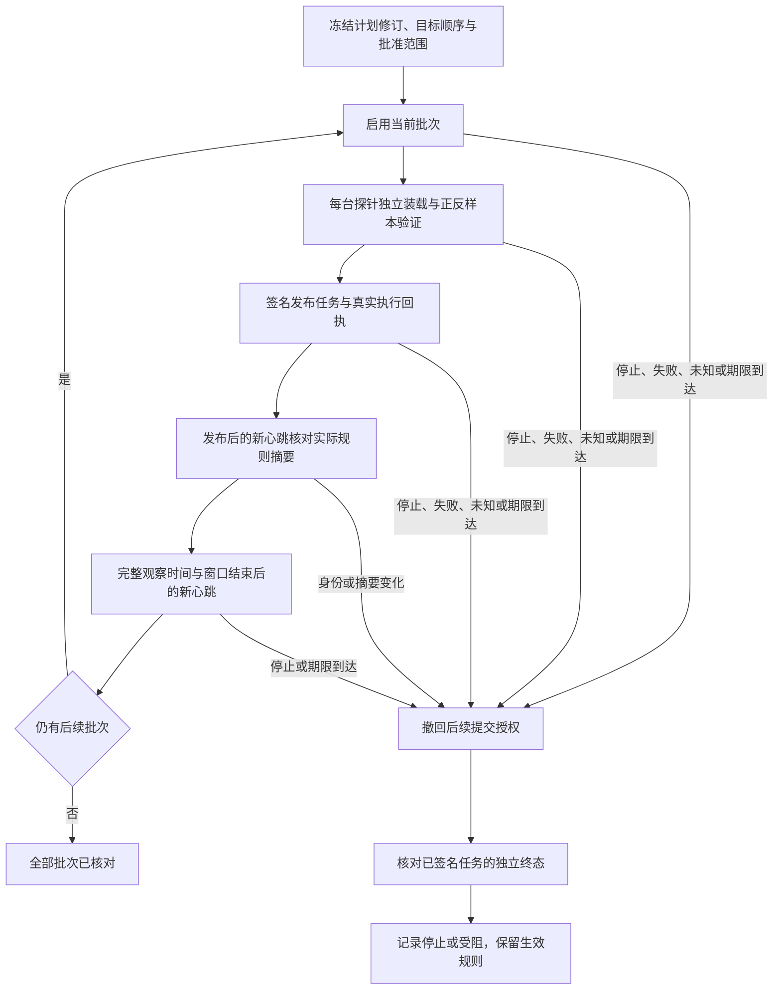

# 星烽 StarBeacon 规则分批发布

主控平台“规则管理 → 规则自动同步 → 分批发布”对固定范围分批启用已批准的同步计划。每台探针独立执行原生装载、正样本重放、反样本重放及规则发布，不能借用其他设备的验证。单探针执行契约见[规则自动同步](规则自动同步.md)。

## 配置与授权

先为各目标保存停用计划，再按执行顺序选择本人批准的 2–200 个计划及修订。所有计划须使用相同规则包修订和正反样本，不含在途运行，且未被其他活动批次预留；各自绑定自己的注册代次。分组成员变化、新规则修订和在线状态均不会扩大范围。

创建、快照、目标预留及审计在同一 PG 事务提交。实际设备任务复用既有签名、采集器持久队列和发布资格，不引入新的服务依赖。预留期间禁止直接修改计划；批次结束并释放预留后，才可重新配置。

| 参数 | 范围与默认值 |
| --- | --- |
| 发布名称 | 1–128 字，无首尾空白及控制字符 |
| 目标顺序 | 2–200 个不同的停用计划及固定修订 |
| 首批探针数 | 1–20，须小于全部目标数；默认 1 |
| 后续每批探针数 | 1–20；默认 10；不承诺同时完成 |
| 每批观察时间 | 30–3600 秒；表单默认 60 |
| 执行期限 | 300–86400 秒，且大于观察时间；表单默认 3600 |
| 档案期限 | 固定“操作日志”类别策略，默认 180 天；活动发布受保护 |

每租户最多 10 个活动批次、10000 个保留档案，24 小时最多创建 1000 次；同步计划自身配额继续生效。前端逐页读取计划，每页 20 项，显示已读取、已选择数量，需要更多目标时显式加载，不把一页目录当作全部数据。提交时再次检查计划修订、注册代次、规则和样本；正反样本实际内容须不同，剩余有效期须超过 31 分钟。执行时继续独立核对样本和原生资格。

核对周期、等待回执及每批观察均占用执行期限。目标较多、批次较小或观察时间较长时，应相应设置期限；默认一小时不保证全部目标均能完成。达到期限会停止后续提交，不自动延长期限或扩大批准范围。

## 批次推进

1. 只启用当前批次。启用生成计划下一修订，与该目标的执行修订同事务保存；重启和重复调度不重复启用。
2. 每个目标逐步创建四份独立任务，保存自己的命令和回执。实际完整规则摘要、原生装载统计及正反样本必须通过既有发布资格。
3. 该批全部运行成功后，等待已发布设备的新心跳。平台接收时间须在该目标运行完成之后，原始健康观测时间也须有效。
4. 核对设备启用状态、注册代次、实际规则文件摘要，并确认没有另一份在途或未核实规则写任务，然后开始观察窗口。前序已发布批次也继续参与核对。
5. 观察时间到达后，还须取得窗口结束后的平台接收水位和健康观测水位，才推进下一批。仅等待墙上时间或保留旧心跳均不能解锁。
6. 最后一批也完成观察后，标记“全部批次已核对”，释放计划预留。原任务与生效事实独立保留。

缺少新心跳、设备离线或存在规则写任务时保持等待，清除本轮观察起点，条件恢复后重新观察。规则摘要、目标身份或批准计划变化，验证失败、执行未知、批准账号失效或期限到达时，停止后续提交。观察门禁只核对上述状态，不证明连续无丢包、检测准确率、内存水位或持续吞吐达到生产要求。

发布回执核对当时的原生进程、重载及规则数量；后续观察窗口目前核对心跳时间、注册身份、登记规则文件摘要和规则写任务，不持续复核检测进程存活、实际引擎装载摘要或规则数量。文件摘要一致不代表引擎仍在运行。持续引擎健康、质量指标和效果门禁仍属于生产灰度的交付缺口，当前“全部批次已核对”不授予这些资格。

调度沿用平台持久同步轮询：每轮最多八个租户，每租户核对两个到期批次，通常间隔五秒检查；设备仍遵循自身同步核对周期和在途约束。目标与对应运行通过有界关联读取，避免逐行查询历史。上述预算是实现上限，不是 200 台探针的吞吐、时延或故障恢复承诺。

## 停止与未知结果

任一本租户管理员可填写原因停止。平台在同一事务停用已启用计划，停止后续阶段和批次；尚未启用的目标不产生执行任务。停止入口不依赖样本或任务签名服务。

“停止提交，等待在途回执”表示已撤回后续提交授权，不表示已签名任务已取消。已经下发的验证、重放或发布仍须独立终态；生效规则继续保留。期限到达同样只停止后续提交，不能把未知副作用改写成未执行。执行器恢复后继续核对原回执；未核实发布使用独立核实入口，不自动重发或回滚。

完成状态返回 `observed` 原因码；成功档案中保留的观察阶段码按成功终态解释，读取不修改原任务或数据库记录。

相同发布标识和输入只回读原对象，不接受不同名称、顺序或修订覆盖。停止按原对象、操作者和原因核对，不同输入不能改写原事实。浏览器超时或回执不完整时冻结原请求，提供“核对原提交”；账号变化或卸载取消请求，迟到响应不得恢复其他身份的数据。

## 页面、接口与留存

目录、目标详情和单台验证弹窗分别展示，同时至多一张业务列表。详情保留固定计划、注册代次、规则修订、样本、批次、执行授权修订、四个任务链接、观察起点、执行截止及档案到期。目录读取失败不显示为无数据，详情失败清除旧快照；详情核对后的状态同步回目录，返回时保留已确认的阶段。

| 接口 | 用途 |
| --- | --- |
| `GET /api/v1/rule-rollouts` | 本租户管理员游标目录，每页最多 20 项 |
| `POST /api/v1/rule-rollouts` | 批准固定计划修订和顺序 |
| `GET /api/v1/rule-rollouts/{id}` | 目标及该执行修订的验证回执 |
| `POST /api/v1/rule-rollouts/{id}/stop` | 停止原因、后续授权撤回与原提交核对 |

终态档案到期后不可读取。清理只删除到期终态发布及目标快照，保留活动同步计划；活动或仍在保留期的发布保护关联运行，运行继续保护任务回执。未结束发布不因期限到达清理，避免将档案缺失推定为可以重发。

当前不包括外部渠道订阅、TUF、自动跟随未批准修订、性能或检测效果评分、自动故障回退、多探针采集配置编排。完整容量和全场景验收仍按[107 项需求](功能实现与验收状态.md)执行。原生双探针和 PG 故障用例分别为 `tests/integration/rule_rollouts_native_test.go`、`tests/integration/rule_rollouts_test.go`；PG 人工状态夹具不代表设备实际发布结果。
